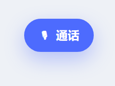
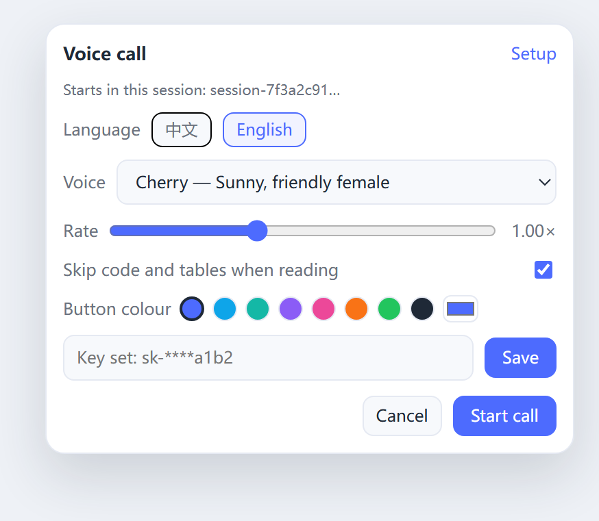
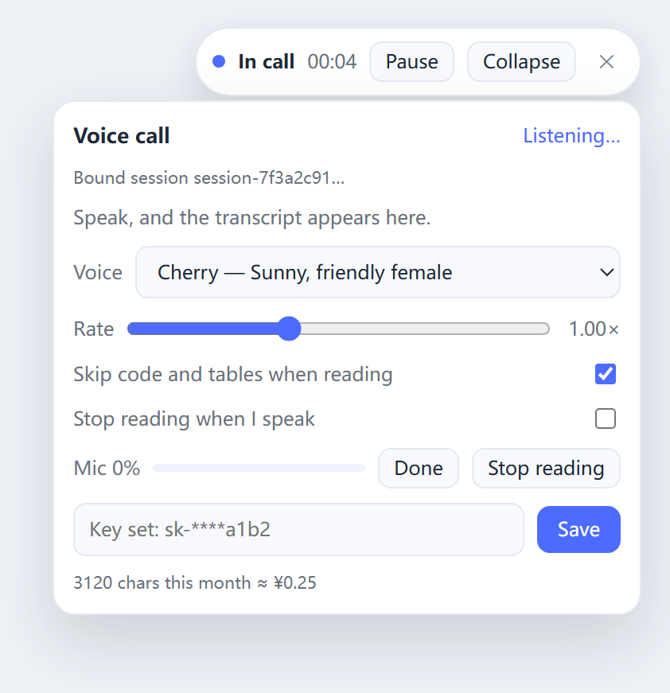

# dsh-voice-call

English | [中文](README.zh.md)

A DeepSeek Harness bundle that turns the current session into a hands-free voice
call: speak instead of typing, hear the assistant's reply read aloud, and keep
the normal transcript in the conversation.

It is a **presentation layer**, not a second agent. Transcriptions are ordinary
user messages, replies are ordinary assistant messages, and no separate session,
writer, or ACP bridge is created. Closing the call leaves DSH exactly as it was.

## What it does

| Direction | Path |
| --- | --- |
| Voice in | microphone → 16 kHz mono WAV → Host `/voice-call/transcribe` → the profile's `speechController` (`sensevoice-local`) |
| Voice out | assistant turn text → cleaning + chunking → Host `/voice-call/tts` → Alibaba DashScope `qwen3-tts-flash` → one audio element |

The floating widget renders into the `shell.overlay` slot, so it stays above
every panel and survives switching sessions. A call is bound to the session that
was active when it started; switching sessions does not move the binding.

## Screenshots

The call button sits at the bottom right. It opens the setup panel first, so no
microphone is touched until you press **Start call**:



| Setup | In call |
| --- | --- |
|  |  |

The widget follows the language chosen in the setup panel (中文 / English), and
the button colour picked there applies to the whole call UI. Screenshots are
rendered from the plugin's own components with demo content.

## Usage

1. Click **🎙 通话** at the bottom right. It opens a **pre-call panel** instead of
   starting immediately.
2. Choose the interface language (中文 / English), voice, rate, speech cleaning
   and button colour there; paste the API key on the same panel when none is
   configured yet.
3. Press **开始通话**. The panel becomes the call card, the microphone opens, and
   what you say arrives as a normal user message.
4. **暂停** stops listening and playback; **打断** stops only the current reading;
   **✕** ends the call.

The button colour and the cleaning switch are per browser (`localStorage`); the
voice and rate are stored with the profile.

## Requirements

- **DeepSeek Harness 0.2.x** (verified on `0.2.1-rc.2`). The bundle declares no
  DSH peer range, so a newer Harness still loads it; a changed internal API shows
  up as an error inside the widget instead of a broken profile.
- **A speech-to-text provider.** Voice input uses the profile's
  `speechController` with the local `sensevoice-local` provider, shipped in the
  optional **experimental voice input** bundle. Enable that bundle under
  **Plugins**; without it the plugin still installs, and the widget says that
  recognition is unavailable.
- **An Alibaba Cloud DashScope API key** for text-to-speech
  (`qwen3-tts-flash`). Billing is per character and belongs to the user's own
  account.

## Install

Any of these installs the same bundle; the Plugin Manager path needs no shell.

1. **Plugin Manager (recommended).** Sidebar → **Plugins** → **Add plugin** →
   **Install third-party plugin**, then paste a Git address
   (`https://github.com/Qi-95827/dsh-voice-call`) or a local absolute path.
2. **CLI, from Git:**
   ```sh
   dsh plugin --profile <profile> add github:Qi-95827/dsh-voice-call
   ```
3. **CLI, from a local checkout:** the absolute directory containing this
   `README.md`. The package is linked, so keep the directory in place.
   ```sh
   dsh plugin --profile <profile> add <absolute directory>
   ```

Restart DSH once afterwards so the Host half and the Client module come from the
same generation, then confirm **语音通话 / Voice Call** is listed and enabled in
**Plugins**.

### Or let DSH install it for you

Copy the whole block below into a DeepSeek Harness chat and let the agent do the
install:

```text
Install a DeepSeek Harness plugin (a bundle) into the current profile and confirm it works.

Plugin: dsh-voice-call
Source: https://github.com/Qi-95827/dsh-voice-call

Do it in this order:
1. Prefer your plugin-management capability: plugin_manager with action install_bundle,
   targeting the address above.
   If that tool is not available in this profile, run in the shell:
   dsh plugin --profile <current profile> add https://github.com/Qi-95827/dsh-voice-call
   The profile name is in DSH_PROFILE ($env:DSH_PROFILE in PowerShell).
2. Do not hand-edit the profile's package.json or cordis.patch.yml; let the installer write them.
3. Tell me when something needs approval or a restart.
4. When it finishes, report: which profile it went into, whether a restart is needed, and
   which version pnpm actually installed.
5. Remind me to restart DSH, then ask me to confirm "语音通话 / Voice Call" appears under Plugins.
6. Also check whether this profile has the experimental voice-input bundle enabled (it provides
   speechController and sensevoice-local). If not, tell me how to enable it, otherwise speech
   recognition will not work.
7. If the install fails, paste pnpm's raw error instead of guessing a cause.

Afterwards, walk me through setup if needed: the Alibaba Cloud DashScope API key and a voice.
```

The block above already points at this repository (`Qi-95827/dsh-voice-call`).
If you fork it, change both URLs inside the block.

## Configure

Open the call widget and paste an Alibaba Cloud DashScope API key (`sk-…`).

- With a credential store in the profile, the key is stored under
  `DASHSCOPE_API_KEY` in the credential store — never in a settings document.
- Without one, it falls back to `~/.dsh/voice-call.json`, and a key already
  there is migrated into the credential store on first use.
- `DASHSCOPE_API_KEY` in the environment works as a last resort.

Non-secret preferences (voice, rate, monthly character count) live in
`~/.dsh/voice-call.json`. The interface language, the "朗读清洗" switch and the
button colour are per browser and stored in `localStorage`; the colour defaults
to DeepSeek blue (`#4D6BFE`), is picked from swatches or any custom value, and is
offered only in the pre-call panel — the in-call card does not show it, so it
cannot be changed by accident mid-call.

## Behaviour notes

- **“打断” stops the reading only.** It aborts the current speech fetches, clears
  the queue, and keeps the agent generating. Speaking again while the turn is
  still running sends that message with `steer`.
- **Speech starts while the reply streams.** Each completed sentence (or 90
  characters, whichever comes first) is synthesized immediately instead of
  waiting for `turn/end`, so the first audio no longer waits for the whole
  reply. The remaining delay is the DashScope round trip and synthesis time.
- **Reasoning is never read.** `reasoning-delta` chunks and `reasoning` /
  `thinking` blocks are filtered out before speech.
- **One engine per page.** A live instance owns the microphone and the widget
  through `window.__dshVoiceCallOwner`; a second one (hot reload, or a stale
  copy left by an earlier manual install) disposes the first before mounting,
  so the same sentence cannot be recorded and sent twice.
- **Tables and code are optional.** With 朗读清洗 on, fenced code, tables,
  Markdown markers, links, and bare URLs are stripped for speech only — the
  conversation still shows the original text.
- **Pause** stops listening and playback without ending the call.
- **The widget speaks Chinese or English.** The switch lives in the setup panel
  and is applied to every label, phase and control; it is stored per browser.
  Errors returned by the Host or by DashScope stay in the language that produced
  them.
- `GET /voice-call/diagnostics` returns the plugin's apply count and the last 40
  speech requests (arrival time, audio bytes, client instance tag, characters).
  It is the fastest way to prove whether one or several client instances are
  talking to the Host.

## Privacy and security

- Microphone audio is recorded in the page, converted to WAV, and posted to the
  local Host. Recognition runs through the profile's own provider; nothing is
  uploaded to a speech service beyond what that provider already does.
- The transcript becomes a normal user message, so it is stored in the session
  log like typed text.
- Spoken text is sent to Alibaba DashScope for synthesis. That request carries
  the reply text and the API key.
- The key lives in the credential store (`DASHSCOPE_API_KEY`), not in a settings
  file, and is never returned to the page — only a masked hint.
- `/voice-call/*` is served by the local Host: same-origin requests only, and the
  server binds loopback by default. A non-loopback bind in the profile would
  expose it to that network, so keep the default.

## Upgrade expectations

- The package declares no `peerDependencies` on DSH packages, so a Harness
  upgrade never refuses to load it. `dsh.compatibility.dshReleases` records the
  release it was verified against for the Plugin Manager.
- Host APIs used: `webServer.register`, `speechController.transcribe/prepare`,
  optional `credentials.resolve/set/unset`.
- Client APIs used: `slots.inject/register`, `sessions.retain`,
  `uiSession.current`, `binding.session.prompt/cancel`, `binding.eventSource`.
- All registration happens inside `apply` through `ctx.effect`; the Client
  component owns no DOM outside its slot.

A future release that renames one of those APIs fails inside this bundle (the
widget shows the error) instead of affecting the rest of the Harness.

## Files

| File | Role |
| --- | --- |
| `index.js` | Host plugin: HTTP routes, DashScope synthesis, key resolution |
| `client.js` | Client plugin: slot registration, recording, playback, widget |
| `cordis.patch.yml` | Bundle layer that inserts the Host row |
| `locale/*.json` | Plugin Manager title and description |
| `icon.svg` | Plugin icon |
| `README.md`, `README.zh.md` | English and Chinese documentation |

## Development

```sh
npm run check   # package.json, BOM, bundle patch, locales, icon
npm test        # component contract and speech pipeline, no browser needed
```

`npm run check` exists because a stray UTF-8 BOM in `package.json` is enough for
DSH to skip the whole bundle at startup; the check fails loudly instead.

## License

MIT — see [LICENSE](LICENSE).
